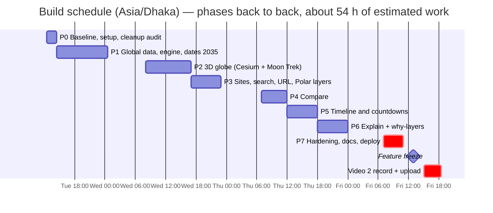

# BUILD PLAN — Lunar Landing Site Navigator (instructions for Claude Code)

> **For the human:** copy this file to `docs/BUILD_PLAN.md` in the repo. Open Claude Code (Opus) in the repo root and paste the prompt for **one phase at a time** (section 9). Run `/clear` between phases. Read each phase report before you say "go".
>
> **For Claude:** you are extending an existing, working, validated app. Read sections 1–6 fully before writing any code. Work **one phase at a time**. At the end of each phase, run the gate (section 6), write the phase report, and **stop**.

Team: Todoke Suisei (Dhaka) · Event: NASA Space Apps 2026, Bangladesh, Nov 13–14 · Plan v3, Nov 10, 2026
**Target: features done Thu night, feature freeze by Fri Nov 13, 1:00 PM (Asia/Dhaka) at the latest.** Fri afternoon and Sat are for videos and the NASA page. The Local Lead confirmed that building before the event is allowed.

**What changed in v3:** the app is now a **whole-Moon 3D globe like Google Earth**, built with **CesiumJS** and **NASA Moon Trek** imagery tiles that get sharper as you zoom (about 100 m per pixel). Users tap famous sites or any point anywhere and compare them. The existing **high-resolution south-pole engine stays** as the precision core.

---

## 1. The challenge (official statement, summarised)

**Lunar Landing Site Navigator** (topic: CLPS). Build an intuitive tool that lets **mission planners, educators and the public compare landing sites and dates quickly**, showing the **Sun and Earth relative to the horizon** to judge **power** and **direct-to-Earth (DTE) comms**. The context is CLPS and lunar missions in general, and the problem is "particularly acute" at the south pole. Planners must re-evaluate **alternative sites in the same region, or alternative dates at the same site**, when schedules slip. Existing tools (Quickmap, Moon Trek, JPL Horizons) are hard to use for fast comparison.

| ID | Objective (all "may consider") | How we answer it |
|---|---|---|
| O1 | Curated sites (Apollo, CLPS targets, commercial, other countries) **and custom coordinates**; side-by-side or sequential compare | Globe with tappable sites anywhere, search, typed coordinates, compare up to 4 |
| O2 | Dates and times; changes across lunar days and seasons | Dates **2026–2035**, timeline, play, same-site date compare; season view (optional) |
| O3 | Sun and Earth vs the horizon; **time left before sunset or Earthset** | Surface view, countdown chips |
| O4 | **Solar elevation angle (display prominently)**, sunlight duration, Earth windows | Big Sun-elevation readout, metrics, window list |
| O5 | 2D maps, 3D surfaces, other views | 3D globe, high-res polar map, first-person surface view |
| O6 | Animations or timelines over a lunar day or several days | Live terminator on the globe, draggable timeline |
| O7 | Experts and the public | **Public-first UI with layered "why" explanations** (verdict → why checklist → the science), plus explainers |
| C1 | Make **lunar vs terrestrial extremes** obvious | Built-in "Apollo 11 vs Shackleton rim" comparison |
| C2 | Explain **why small changes in location or date have big effects** | "Move a little" sensitivity ring, ±24 h compare |
| C3 | Real topography, **no refraction**, libration, steep slopes and craters | LOLA horizons with curvature; libration is inside SPICE and explained |
| C4 | Help when schedules slip | Shareable scenario links; same site with different dates side by side |

The Resources tab is "to be added before the hackathon". Check it on Nov 13 and don't guess what it will contain.

---

## 2. The product

**One sentence:** spin the Moon, tap a famous landing site or any spot, pick a date, and *see* when a lander has power and when it can talk to Earth. Then compare sites and understand why they differ.

**Primary flow:** Globe → tap a site → answer cards plus timeline → "+ Compare" → tap another site → compare drawer.

**Design rules: simple, interactive, animated**

| Principle | In practice |
|---|---|
| One primary flow | Globe first. Everything else is one tap deeper. |
| Show first, numbers second | Light on the globe, bars on the timeline, then numbers. Each card shows **at most 3 headline values**; the rest go under "Details". |
| Everything is linked | Changing the time anywhere moves the globe's day/night line, the timeline playhead, the surface-view Sun and Earth, and the countdowns together. Hovering a site highlights it everywhere. |
| Direct manipulation | Spin and zoom the globe, tap to pick, drag the playhead, drag the antenna mast. Gestures over forms. |
| Motion explains, never decorates | Camera fly-to, the terminator sweeping, bars sweeping in, numbers rolling. 150–350 ms (fly-to up to 1.2 s), ease-out, `transform`/`opacity` only. **Off under `prefers-reduced-motion`.** |
| Public first, experts one tap deeper | Plain words on screen ("Power", "Talk to Earth"). Every verdict, badge, layer and icon has a **"why" popover**: a checklist with live numbers, then "Show the science" (method, data, thresholds, sources, limits). No mode switch. See P6e. |
| Honest resolution | Every result shows its terrain source badge: **"Polar HD · 120 m"** or **"Global · ~1.9 km"**. |

---

## 3. The existing codebase (read before coding)

Read `README.md` in full. **Extend working modules; don't rewrite them.**

```
pipeline/            Python 3.11+, scripts 00–09 (SPICE, LOLA polar DEM, Horizons fixtures, Python references)
data/fixtures/       horizons.json, horizon_reference.json, hours_reference.json
web/                 React 19 + Vite 8 + Tailwind 4 + shadcn/ui + Zustand 5 + Leaflet 1.9 + three 0.186 + motion 13
  public/data/       manifest.json, ephemeris.bin, dem_near.bin (120 m, 84°S→pole), dem_far.bin (240 m, 80°S→pole),
                     slope_plane.bin, slope_max.bin, hillshade.png, craters.json   (Git LFS)
  src/state.js       ONE Zustand store + compute controller (horizon worker → recomputeHours, rAF-coalesced)
  src/engine/        hours.js, horizon.js + horizon.worker.js, ratings.js, earthDays.js, data.js, geometry.js,
                     projection.js, craters.js
  src/view/surface.js   three.js first-person surface view
  src/map/map.js        Leaflet polar stereographic map
  src/components/      AppBar, MapPanel, SurfacePanel, TimeBar, DatePicker, sidebar/*, welcome/*, ui/* (shadcn)
  src/lib/format.js    THE ONLY place hours → days conversion happens
  test/                Vitest, 48 tests
```

Key facts:
- Ephemeris: SPICE DE440s, frame `MOON_ME`, `LT+S`, Sun and Earth vectors from the Moon's centre every 900 s, 2026–2030 (extended to 2035 in Phase 1). **It already works for any lat/lon on the Moon**; only the horizon terrain is polar-only today.
- Horizon: 720 azimuths, marched to 200 km with curvature, in a Web Worker (about 0.1 s).
- Sun observed from a fixed 2 m height; Earth from the antenna height (2/5/10/15 m). `sunMode` supports `"center"` and `"any_part"`, but there is no UI for it yet. `MISSION_STAY_H = 156`.
- `loadAll()` in `engine/data.js` currently loads **all** data at startup. This must become tiered (Phase 1).
- Dev hooks: `lspb.setPinLatLon`, `lspb.setTimeUtc`, `lspb.state()`; dev URL `?screen=app&pin=lat,lon&t=ISO&view=surface`.
- Existing validation must stay green: Horizons error 0.000022° (tol. 0.1°); JS vs Python horizon < 0.00001°; hours within 0.25 h.

---

## 4. Ground rules (non-negotiable)

1. **Never break existing validation.** Lint, tests and build pass at the end of every phase. Never loosen a tolerance.
2. **Engine works in hours; the UI converts only through `lib/format.js`.**
3. **Calculations never use the network.** All engine data (ephemeris, DEMs, sites, craters) is generated by the pipeline into `web/public/data/`. **The only runtime network use allowed is globe imagery tiles from NASA Moon Trek** (display only). If tiles fail or the app is offline, the globe falls back to a bundled texture and everything else keeps working.
4. **No invented coordinates, numbers or facts.** Every curated site needs a `source_url` you actually fetched and a `source_note`. If unverified, set `"verified": false`, show an "unverified" tag in the UI, and list it in the report.
5. **Pure engine functions with tests first, UI second.**
6. **Heavy compute stays off the main thread** (worker or rAF-coalesced). Large typed arrays never go into React state.
7. **Dependencies:** use what is installed, **plus `cesium` (Apache-2.0) for the globe only**, loaded as a lazy chunk with its static assets copied by the Vite build. three.js stays for the first-person surface view. **Do not add** other globe libraries, chart libraries, UI kits or AI SDKs. No Cesium ion and no terrain provider (team decision, see P2.3). If something else truly needs a new package, stop and ask.
8. **Do not change rating thresholds** in `ratings.js`.
9. **Out of scope:** AI chatbot, user accounts, live Horizons backend, real-time multiplayer.
10. **Polar HD vs Global:** a site inside the polar data (84°S–90°S) uses the existing 120/240 m grids. Anywhere else uses the global DEM. The **Landing (slope) rating is only given in Polar HD**; elsewhere it shows "Not assessed (coarse terrain)". Never mix the two silently.
11. **Data budget:** first load (before any pin, excluding streamed imagery tiles) ≤ 10 MB transferred. The Cesium chunk loads lazily when the globe opens. The global DEM and polar grids are **lazy-loaded** the first time they're needed, with a progress indicator.
12. **Git:** branch `feature/navigator`. Commit after each task. Merge into `main` only after the gate passes and the human says go.
13. **Accessibility:** keyboard reachable, visible focus, labels on custom controls, contrast ≥ 4.5:1, reduced motion respected, works at 360 px wide.
14. Update `README.md`, `docs/VALIDATION.md` and `CHANGELOG.md` **as you go**.
15. **Remove redundant code. We are building on an older repo, so leave no dead weight.**
    - **Replace, don't duplicate.** When a new feature supersedes old code, delete the old code in the same phase. Never keep two versions "just in case"; git history is the backup.
    - **Prove it's unused before deleting it:** search for imports and usages, then run `npm run lint && npm test && npm run build`. Anything referenced by the pipeline, tests or `manifest.json` is not dead.
    - **Never delete** validation scripts (`pipeline/05`–`08`), fixtures in `data/fixtures/`, `LICENSE`, attribution files, or anything the README cites as evidence.
    - Make deletions **separate commits** (`chore: remove …`) and list them in the phase report under "Removed".
    - No commented-out code blocks, no unused exports, files, components, CSS classes, constants or npm packages, and no leftover TODOs without an owner.

---

## 5. Target layout

```
┌ AppBar: name · [Search sites ⌘K] · [?] ────────────────────────────────────────────┐
├──────────────────────────────────────────────────┬────────────────────────────────────────┤
│ MAIN VIEW   [ Globe | Polar HD | Surface ]       │ SIDEBAR                                 │
│                                                  │  Apollo 11 · 0.67°N 23.47°E · Global    │
│   GLOBE (default): LRO colour Moon, real Sun     │  ┌ Power   Sun +12.4°   Sunset in 211 h ┐│
│   lighting (terminator moves with time), Earth   │  ┌ Talk to Earth        Always in view  ┐│
│   in its true direction, site markers by group,  │  ┌ Landing  Not assessed (coarse)       ┐│
│   tap anywhere → pin, fly-to on select,          │  [+ Compare]  [Move a little]  Details ▸ │
│   chip "Open Polar HD" near the south pole       │                                         │
├──────────────────────────────────────────────────┴────────────────────────────────────────┤
│ TIMELINE  ☀ ▇▇▇▇▁▁▁▇▇  🌍 ▇▇▇▇▇▇▇▇▇  ◆ both   ← draggable playhead · one group per site        │
│ Date · Play · speed · mission [156 h | 336 h]                                               │
└──────────────────────────────────────────────────────────────────────────────────────────┘
 COMPARE drawer slides up: 2–4 site columns; the best value in each row glows.
```

On a phone, everything stacks: globe → summary strip → cards → timeline. Compare becomes a swipe carousel.

---

## 6. Phase gate protocol (end of EVERY phase)

1. `cd web && npm run lint && npm test && npm run build`. All green; paste the summary lines.
2. Run the phase's own checks (pipeline validation scripts if touched).
3. Check the phase's manual items in `npm run preview` using the dev hooks. Report what you actually observed and say which checks you could not do.
4. Append the numbers to `docs/VALIDATION.md` (date, phase, check, value, tolerance, pass or fail).
5. Update `CHANGELOG.md` and any README sections you touched. Carry out the `docs/CLEANUP.md` items marked for this phase and tick them off.
6. Write the phase report, then **STOP**.

```
## Phase N report
Done:
Tests: X passed / Y skipped / 0 failed (+N new). Lint: clean. Build: OK, main chunk X kB (baseline Y). First-load transfer: X MB.
Validation rows added:
Removed (dead or superseded code, with proof it was unused):
Needs human check:
Known issues / deferred:
Next phase ready: yes/no
```

---

## 7. Phases



**Freeze rule:** the target freeze is **Fri Nov 13, 1:00 PM**, so Phase 7 can run at the venue on Friday morning. If Phase 6 isn't done by **Thu 11:00 PM**, cut from the list below until it is. **Video 2 (6:30 PM Friday) must never be put at risk.** Live shadows (P6g) are only attempted if P6 finishes early.

**If a phase overruns, cut in this order:** P6c season heatmap → crater hover details (P2.7) → South Pole HD overlay blending polish (P2.2) → live shadows (P6g) → export (P6f). **Never cut** P1, P2 core (P2.0–P2.2, P2.4–P2.9), P3, P4, P5, sensitivity (P6a), explainers (P6b) or the layered "why" explanations (P6e).

---

### Phase 0 — Baseline and setup (≈2 h)

1. Create the branch `feature/navigator`. Confirm the LFS data files are real files, not pointer stubs.
2. Run `npm ci`, lint, test and build. Record the baseline in `docs/VALIDATION.md`: test counts, main chunk size, and first-load transfer size (measure it).
3. Change the user-facing challenge name to **"Lunar Landing Site Navigator"**. Keep the product name "Lunar Mission Planner" unless told otherwise.
4. Create `CHANGELOG.md` ("Before the hackathon" / "At the hackathon").
5. Add a root `CLAUDE.md` (under 40 lines) that points to `docs/BUILD_PLAN.md` and repeats rules 1–11.
6. Note how the Vercel deploy works (`web/vercel.json`). Don't change it.
7. **Redundancy audit** → write `docs/CLEANUP.md` with three lists: *remove now*, *remove when replaced (which phase)*, and *keep (why)*. Then do the *remove now* items. Use a one-off `npx knip` (or a grep-based import graph) to find unused files, exports and dependencies. **Don't add knip to `package.json`.** Known candidates to check:
   - `.vite/deps/` committed at the **repo root**: this is a build cache. Remove it from git and add it to `.gitignore`.
   - Unused shadcn components in `src/components/ui/` and unused npm dependencies.
   - Dev-only URL parsing (`devParams` in `state.js`, `?slide=` in the welcome flow): becomes production URL state in Phase 3.
   - `MISSION_STAY_H` used as a constant: replaced by the store's `missionH` in Phase 1.
   - `TimeBar` slider vs the new timeline playhead (Phase 5): keep **one** time control, not two.
   - `MapPanel`/`map/map.js` becomes the "Polar HD" view (Phase 2). Rename it rather than duplicating it.
   - `MobileSummary` vs new card summaries, and the earthDays calendar vs the season view: merge or remove.
   - Hard-coded ephemeris start/end dates in `state.js`: derive from the manifest (Phase 1).
   - Any separate tooltip text that becomes part of the shared `<Why>` component (P6e).
   - Duplicate Sun/Earth card logic once countdowns and metrics are added (keep the shared `BodyCard`).
   - `.gitkeep` files in folders that now contain files.

**Gate:** green, baseline recorded, app behaves exactly as before, and `docs/CLEANUP.md` is written.

---

### Phase 1 — Global data and engine (≈8 h) · no visible UI change except loading

**Data (pipeline)**
1. `pipeline/10_build_global.py`:
   - **Offline fallback texture** from NASA SVS **CGI Moon Kit** (https://svs.gsfc.nasa.gov/4720): one JPEG at 4096×2048, centred on 0° longitude, used only when Moon Trek tiles can't load. Credit: NASA's Scientific Visualization Studio, with LROC data from NASA/GSFC/Arizona State University.
   - **South Pole HD overlay:** reproject the existing 120 m polar hillshade from polar stereographic to a geographic (lat/lon) image for 80°S–90°S (rasterio warp), so Cesium can drape it as a sharp layer over the pole.
   - **Global horizon DEM**: a LOLA global gridded DEM (prefer the PDS LOLA GDR `LDEM_16`, about 1.9 km per pixel at the equator; verify the URL, format and reference radius 1737.4 km before using it). Write `global_dem.bin` (int16, equirectangular) and add its spec to `manifest.json`.
   - **Size decision:** if the compressed transfer of 16 ppd is ≤ 20 MB, use it. Otherwise use 8 ppd. Record the decision and the sizes.
2. Extend `03_horizons_fixtures.py` with **3 non-polar reference sites**: Apollo 11, a far-side site such as Chang'e-4, and a mid-latitude site (coordinates from cited sources). Extend `05_validate_ephemeris.py` to check them. The tolerance stays 0.1°.
3. Extend `07_horizon_reference.py` with a Python reference horizon on the global DEM at 2 non-polar sites.
3a. **Extend dates to 2026–2035.** Re-run `02_build_ephemeris.py` to 2035-12-31 (check the kernels cover it; `de440s` does).
   - **File size:** today's 900 s step gives about 4.2 MB for 5 years, so 10 years would be about 8.4 MB. **Prefer a 1800 s step** to keep it about 4.2 MB, *if* the interpolation error, measured against a 60 s reference, stays under **0.001°** for both bodies (expected about 0.0002°). Otherwise keep 900 s and lazy-load 2031–2035 as a second file. Record the decision and the measured error.
   - Remove the hard-coded `EPHEMERIS_START_UTC_MS` / `EPHEMERIS_END_UTC_MS` in `state.js` and derive them from `manifest.json` (rule 15).
   - Add Horizons fixtures for 2 dates in 2033–2035 to `03` and `05`; tolerance 0.1°.
3c. **Shadow data for Polar HD:** look for a freely downloadable NASA LOLA south-pole **average illumination** map and/or **permanently shadowed regions (PSR)** map (start at NASA GSFC PGDA, https://pgda.gsfc.nasa.gov, and PDS LOLA). Check its licence (NASA data is normally public), resolution and projection. Reproject it to our polar stereographic grid and write `web/public/data/illum_avg.png` and/or `psr.png` (lazy-loaded, ≤ 5 MB each) with their specs in `manifest.json`. **If none is available, stop this item and report it.** Never fake a shadow map.
3b. **Global crater names:** extend `09_build_features.py`, which already downloads the IAU Gazetteer, to also write `web/public/data/craters_global.json`. Keep IAU-approved craters (plus named maria, montes and valles if cheap) with `name, lat, lon, diameter_km, type`, and add a `rank` from diameter for level-of-detail. Keep the existing polar `craters.json` unchanged. Record the count and file size (target ≤ 1 MB, gzipped smaller).

**Engine (web)**
4. **Tiered loading** in `engine/data.js`:
   - `core`: manifest and ephemeris, loaded at start.
   - `globe`: textures, loaded at start.
   - `global`: the global DEM, loaded on the first non-polar pin.
   - `polar`: the polar grids, slope and hillshade, loaded on the first polar pin or when Polar HD opens.
   Show progress for each tier. Update `DataStatus`.
5. **`engine/horizonGlobal.js`**: great-circle march on the equirectangular DEM (bilinear sampling, longitude wrap, correct near the poles), with step equal to the DEM pixel size, out to 200 km, including curvature. It returns the same 720-bin `Float32Array` as `horizon.js`. Run it in the worker.
6. **Terrain source router:** `horizonFor(pin)` → Polar HD if the pin is at 84°S or further south and polar data is available, otherwise Global. Results carry `terrainSource: "polar-hd" | "global"` and `resolutionM`.
7. **Metrics** (`engine/series.js` and `engine/metrics.js`):
   - `sampleVisibility` returns intervals refined to 0.01 h.
   - `sunlitFraction`, `earthFraction`, `bothFraction`, `sunUpEarthDownH`, `longestDarkH`, `longestNoEarthH`, `nextWindows(n = 5)`.
   - `clearanceDeg` (body elevation minus horizon elevation at the body's azimuth).
   - `sunElevationNow`, plus min and max Sun elevation over the mission window (O4: "solar elevation angle, prominently").
8. Store: `missionH` (156 or 336), a `setSunMode` setter, and `terrainSource` in the results.
9. A Python reference for the metrics: `data/fixtures/metrics_reference.json` at 2 polar and 2 non-polar sites.

**Tests (new)**
- Global horizon: a flat synthetic DEM gives a horizon of about 0°; a single synthetic pillar matches the analytic angle (as in the existing test); longitude wrap at 180°/−180°; JS vs Python reference within **0.2°**.
- At a polar site at about 86°S, compare the Global horizon with the Polar HD horizon and **record** the difference (no pass/fail; it documents why Polar HD matters).
- Non-polar Horizons fixtures: az/el error < 0.1°. 2033–2035 fixtures: error < 0.1°. Interpolation error at the chosen step < 0.001°.
- Metrics: synthetic cases (always visible, never visible, grazing double crossing, cut off at the end of the ephemeris); JS vs Python fractions within 0.25 h / missionH.
- Tiered loading: the polar tier is not fetched when only a non-polar pin is used (mock fetch).

**Manual check:** `lspb.setPinLatLon(0.674, 23.473)` (Apollo 11) returns Sun and Earth results with `terrainSource: "global"`. A polar pin still behaves exactly as before.

---

### Phase 2 — The 3D globe, Google Earth style (≈9 h) · centerpiece · covers O1, O5, O6, C1

New `src/view/globe.js` (CesiumJS) and `components/GlobePanel.jsx`, lazy-loaded like `SurfacePanel`.

0. **Spike first (≤ 1 h), then report before continuing:**
   - Set up Cesium in Vite (copy its static assets, set `CESIUM_BASE_URL`).
   - Use `Ellipsoid.MOON` as the default ellipsoid. Turn off the default Earth imagery and ion.
   - Load the **Moon Trek LRO WAC global mosaic** as a `WebMapTileServiceImageryProvider`. Take the exact URL, layer, tile matrix set and format from its `WMTSCapabilities.xml`; never hard-code a guess. (Layer seen: `LRO_WAC_Mosaic_Global_303ppd_v02`.)
   - Check: (a) tiles load from `localhost` and from the Vercel URL (**CORS**); (b) the tiles line up with the 0° meridian and with Apollo 11's coordinates; (c) frame rate.
   - **If CORS blocks the tiles:** write `pipeline/12_mirror_tiles.py` to download zoom levels 0–N (keep it ≤ 100 MB) into `web/public/tiles/` and point the provider there. Record which route was used.
1. **Viewer:** turn off Cesium's default widgets (timeline, animation, geocoder, base layer picker, home, navigation help). Keep the credit display. Black space background with a light star field.
2. **Imagery layers:**
   - The LRO WAC global mosaic (Moon Trek) as the base.
   - The **South Pole HD** overlay from Phase 1 (our 120 m LOLA hillshade) for 80°S–90°S, with an opacity slider.
   - The bundled offline texture as a fallback. Switch to it automatically if tiles fail or when `?offline=1` is set, and show an "Offline imagery" badge.
3. **No 3D terrain on the globe (team decision, Nov 10).** The globe is a smooth Moon ellipsoid with sharp imagery. Do **not** add Cesium ion or any terrain provider. Terrain detail for a site is shown in the first-person surface view (three.js, real LOLA skyline), and every number comes from our LOLA engine.
4. **Real Sun lighting:** set `scene.light` to a `DirectionalLight` whose direction is the **Sun vector from our ephemeris at the current time**, and turn on `globe.enableLighting`. Cesium's Moon fixed frame and our `MOON_ME` both have x toward 0° longitude and z toward the north pole; **prove it with a test** (the sub-solar point from the light direction matches the ephemeris at 3 times). The day/night line then sweeps across the Moon when time changes.
5. **Earth:** a billboard in the true Earth direction near the limb, plus a **sub-Earth point** marker on the surface. During Play, its small wobble is libration.
6. **Navigation like Google Earth:** drag to rotate, scroll or pinch to zoom, right-drag or two-finger drag to tilt. **Click** → `pickEllipsoid` → lat/lon → set the pin, with a pulse-ring animation. Keyboard: arrows rotate, +/- zoom, Enter pins the screen centre.
7. **Crater names:** from `craters_global.json` in a `LabelCollection`.
   - **Level of detail:** set `distanceDisplayCondition` by size rank (big craters visible from far away; small ones only when close), plus `scaleByDistance`, with far-side labels hidden.
   - Show at most about 150 labels at once. A **Labels** toggle turns them off.
   - Hover shows the name and diameter; double-click flies to the crater.
8. **Mission pins (simple):**
   - Billboard pins (`PinBuilder`), coloured by group: Apollo, CLPS, Artemis III regions, other countries.
   - **Hovering a pin pops up the mission name** in a small tooltip, with the date in small text if the source gives one. On touch, tap once.
   - Clicking flies the camera there and selects the site.
   - A legend toggles groups. Your own pins and compare pins are numbered and in compare colours.
9. **Go to coordinates:** typed coordinates (Phase 3) call `camera.flyTo` and drop the pin with a short bounce. This works at **both poles**. South-pole pins use Polar HD numbers; the north pole uses Global terrain.
10. **Views:** `[Globe | Polar HD | Surface]`. The globe is the default after the welcome flow; `V` cycles. A **"View from here"** button opens the first-person surface view (three.js) for the selected pin. When looking at 80°S or further south, show a chip "Open Polar HD map" (the existing Leaflet view).
11. A lat/lon grid toggle and a near-side/far-side label.
12. **Performance:** use `requestRenderMode` so the globe doesn't render when idle.

**Tests:**
- lat/lon → Cartesian → pick → lat/lon round trip within 0.05°.
- Sub-solar point vs ephemeris at 3 times within 0.1°.
- The offline fallback activates when the tile provider errors (mock).
- The crater LOD tiers are monotonic (bigger craters are never hidden while smaller ones show).
- Every mission pin has a group and a source.

**Performance:** ≥ 50 fps on desktop and ≥ 30 fps on a mid phone while rotating; record it. Record the Cesium chunk size.
**Manual checks:**
- Zoom from the whole Moon into Shackleton: the imagery sharpens, crater labels appear by size, and the South Pole HD layer blends in.
- Hover the Apollo 11 pin and its name pops up.
- Press Play at 3 d/s and the terminator sweeps smoothly.
- Load with `?offline=1` and the fallback texture appears.

### Phase 3 — Sites, search, coordinates, shareable URL (≈5 h) · covers O1, C4

1. `pipeline/data/sites_source.csv` (hand-curated) with columns `id, name, group, lat, lon, status, mission_date, source_url, source_note, verified`. `pipeline/11_build_sites.py` validates it and writes `web/public/data/sites.json`.
   - Groups:
     - **Apollo** (11, 12, 14, 15, 16, 17).
     - **CLPS**: flown (Peregrine target, if listed; IM-1 Odysseus; Blue Ghost 1; IM-2 Athena), and upcoming targets with published coordinates.
     - **Artemis III candidate regions**: NASA region centres, labelled "region centre, not a landing target".
     - **Other countries**: Chang'e 3/4/5/6, Chandrayaan-3, SLIM, Luna 9 and others with published coordinates.
     - **South-pole reference points**: Shackleton rim, connecting ridge.
   - **Fetch each source with WebFetch** and follow rule 4.
2. **Search (⌘K or Ctrl-K, plus a button):** results grouped by category, each showing its status (landed, planned, region). Selecting one flies the globe there (or pans Polar HD, if that's the active view).
3. **Typed coordinates** anywhere on the Moon: accept `-89.45, 222.7`, `89.45S 137.3W` and `0.674N 23.473E`, with clear errors for bad input.
4. **Polar HD map layers** (Leaflet view), each with a toggle, opacity slider, legend, a **value under the cursor**, and a `?` explaining it:
   - **Slope:** rendered in the browser from the existing `slope_plane.bin` (no new download). Colours match the Landing rating: green < 8°, amber 8–10°, red > 10°.
   - **Average sunlight %** and/or **permanent shadow (PSR)** from item 3c, labelled with its source and time span.
   - Layers fade in and out (200 ms). The Landing card's `?` links to the slope layer ("see it on the map").
   - Optional: drape the same layers on the globe's south pole.
5. **Shareable URL** in production: sync `site`/`pin`, `t`, `ant`, `mission`, `sun`, `cmp`, `view`, the active layers and the camera, debounced to 300 ms. A "Copy link" button shows a checkmark animation. This is the "schedule slipped, share the alternative" use case (C4).

**Tests:** every site has a source, unique id, and lat/lon in range; the parser handles 12 or more cases; URL round trip restores the store and view.
**Gate extra:** the report lists every site and whether it is verified. **The human checks unverified ones in LROC Quickmap before Phase 4.**

---

### Phase 4 — Compare (≈5 h) · covers O1, C1, C4

1. Store: `compareSites` (max 4), each with its own horizon (from the right terrain source), results and a colour (4-colour, colour-blind-safe palette). Horizon jobs go through the worker queue one at a time. Hours recompute for all compared sites when time, antenna, mission or sun mode changes (rAF-coalesced).
2. "+ Compare" on the sidebar and in the globe tooltip. Compared sites get coloured markers on the globe, joined by thin great-circle arcs that draw in with an animation.
3. **Compare drawer** (slides up): one column per site. Rows: terrain badge, Sun elevation now, Power rating, Talk-to-Earth rating, Landing (or "not assessed"), sunlit %, Earth %, both %, power-but-no-Earth h, longest dark h, next sunset, next Earthset. The **best value in each row glows**. ✕ removes a site with a collapse animation.
4. **"Same site, different date"**: duplicate a column with the date shifted (+1 lunar day, +1 month, or custom). This is the schedule-slip case.
5. **Built-in presets** (one tap): "Equator vs pole: Apollo 11 vs Shackleton rim", "IM-2: planned target vs where it ended up" (only if both coordinates are verified), and "Two Artemis III regions".
6. Phone: horizontal swipe carousel with snap points.

**Tests:** results for a compared site match the single-site path (within 0.01 h); a 5th site is rejected; a date-shifted column uses its own time.
**Performance:** 4 sites in < 1.5 s (Polar HD or Global). Record it.

---

### Phase 5 — Timeline and countdowns (≈6 h) · covers O2, O3, O4, O6

1. `components/TimelineStrip.jsx` (canvas, DPR-aware): for each site, ☀ Sun / 🌍 Earth / ◆ Both rows over 708.7 h, plus a **mission bracket**.
   - A **draggable playhead** bound to `sliderOffsetH`. Arrow keys step ±0.25 h; Shift+arrow ±24 h.
   - Hover a bar for a tooltip with start, end and duration. Click a bar to jump to its start.
   - Bars sweep in when the site changes and cross-fade when settings change.
   - Intervals are computed in the worker or idle time, never on each scrub frame.
2. Dragging the playhead moves **everything**: the globe terminator, the Earth marker, the surface view, the cards and the countdowns. A hover ghost time shows a faint Sun and Earth in the surface view.
2b. **Time-lapse:** Play speeds of 1, 6, 24 and 72 h per second (shown as "1 h/s … 3 d/s"). In the surface view, the Sun and Earth move along their paths with short fading trails, and the skyline stays fixed, so you can watch the Sun dip behind a ridge and Earth bob near the horizon. On the globe, the terminator sweeps at the same moment. A loop toggle replays the current mission window.
3. **Countdown chips:** "Sunset in 42 h" and "Earthset in 9 h", with rolling digits. Green above 48 h, amber 12–48 h, red under 12 h.
4. **Sun elevation readout:** large "+3.2°" on the Power card, with a tiny sparkline of elevation over the mission window (O4: "prominently").
5. A Details list of the next 5 windows per body (each clickable). The mission control [156 h | 336 h] and the "Count partial Sun" toggle go here.

**Tests:** timeline boundaries equal `nextWindows` within 0.01 h; playhead keys work; clicking a bar sets the offset.
**Performance:** scrubbing with 4 sites and the globe visible stays at **≥ 50 fps** on desktop. Record it.

---

### Phase 6 — Explain it (≈5 h) · covers O7, C1, C2, C3

- **(6a) "Move a little" sensitivity (must have).** A ring of 8 points at 250 m, 500 m or 1 km (in Global mode the minimum is 5 km, labelled as such). The points pop in coloured by sunlit % (or Earth % on a toggle). The summary reads like "Within 500 m: sunlight 18%–74%". It also includes a ±24 h date comparison. This is the main answer to C2, so polish it.
- **(6b) Three tiny interactive explainers** (SVG plus motion, each under 150 lines), opened from `?` buttons and reused in the welcome slides:
  - *Why the Sun skims the horizon at the pole:* drag a latitude slider from 0° to 90°S and watch the Sun's daily path flatten.
  - *Why Earth wobbles (libration):* Earth traces a small loop near the horizon over a month.
  - *Why antenna height matters:* drag a mast from 2 m to 15 m and watch the line to Earth clear a ridge.
- **(6c) Season heatmap (optional):** years × months, sunlit % and Earth %, computed in the worker. Click a cell to jump to that date.
- **(6d) Welcome flow:** three slides that use the explainers, with a final button **"Start at Apollo 11 vs Shackleton"** that opens the preset.
- **(6e) Layered "why" explanations (must have; replaces any Expert mode):** one public-first UI where depth is always one tap away.
  - **Layer 1, verdict (always visible):** plain words, colour and icon. For example *"Good for power: Sun stays up 211 h"* or *"Earth only part of the time"*.
  - **Layer 2, why (`?` icon, badge, layer chip or any icon):** a small popover with a **checklist using live numbers vs thresholds**, e.g. "✓ Sun up for the whole 156 h stay (211 h) · ✓ Sun elevation stays above 0.5° · ✗ Earth in view only 31% (needs 100% for Perfect)". Short and scannable.
  - **Layer 3, "Show the science" link inside the popover:** method in 2–3 lines, data used (with terrain source and resolution), the threshold and **its citation**, known error (e.g. ±1.9° LOLA slope), and a link to the matching README section.
  - **Glossary terms** (terminator, libration, DTE, PSR, horizon) are dotted-underlined, and a short definition pops up.
  - **Must work without a mouse:** use Radix **Popover** (opens on hover *and* on tap or keyboard focus, stays open to read, Esc closes), not a hover-only tooltip. Phones have no hover.
  - One shared `<Why>` component and one `explanations.js` content file (every string has a source), so the wording is consistent and easy to edit.
  - Extend the existing `RatingBadge` explanations instead of duplicating them (rule 15).
  - **Tests:** every rating, layer and badge renders a Why popover; each checklist line's ✓/✗ matches the rating function for 3 synthetic cases; opens on keyboard focus.
- **(6f) Export (optional):** a "Site report" PNG of the cards, timeline and sensitivity summary with a citations footer, or a CSV of windows.

- **(6g) Live moving shadows on Polar HD (stretch; only if P1–P6e are done):** precompute, offline in Node using the existing horizon engine, a per-pixel horizon at 72 azimuths on a coarser grid (about 500 m–1 km, 84°S–90°S). Ship it as quantized uint8 (≤ 10 MB, lazy). In the browser, each pixel is lit if Sun elevation > horizon at the Sun's azimuth, so **shadows sweep across craters live as time plays**. Validate against the full 720-azimuth engine at 20 random pixels (lit/unlit must agree at ≥ 95% of sampled times; report the mismatches). Label it "approximate, ~1 km".

**Tests:** sensitivity points lie at the requested radius (within 1%); explainers render under reduced motion; season averages match the earthDays calendar within 1%.

---

### Phase 7 — Hardening, docs, deploy (≈3 h) · feature freeze at the end

1. Full gate, plus pipeline validation scripts `05`–`08`, `10` and `11`. All tolerances pass.
1b. **Final redundancy sweep:** run `npx knip` (one-off) and fix everything it finds. Also remove unused data files in `web/public/data/`, unused CSS and Tailwind tokens, unused store fields and actions, stale README sections describing removed behaviour, and old screenshots. Every `docs/CLEANUP.md` item must be done or have a written reason to keep it. Record the main bundle size before and after.
2. **Performance budget** in `VALIDATION.md`:
   - First load ≤ 10 MB and < 6 s on a mid laptop.
   - Globe at ≥ 50 fps on desktop, with imagery tiles streaming.
   - Polar HD horizon < 0.3 s; global horizon < 0.5 s.
   - 4-site compare < 1.5 s; scrubbing at ≥ 50 fps.
3. **Accessibility pass** at 360 px and on desktop, with keyboard only and with reduced motion.
4. **Published benchmark:** our sunlit % and Earth % at one named polar site vs a published NASA/JPL value. Explain the differences honestly.
5. **README:**
   - A table mapping each challenge objective to a feature.
   - The live link and a validation table.
   - Known limits: Global mode is about 1.9 km and has no landing rating; the texture is for appearance only; slope only; any unverified sites.
   - Data sources and credits (SPICE/NAIF, LOLA PGDA polar DEM, LOLA global GDR, NASA Moon Trek WMTS / LROC WAC mosaic (NASA/GSFC/ASU), CGI Moon Kit, CesiumJS (Apache-2.0), IAU Gazetteer, every site source).
   - **Use of AI:** Claude, representative prompts, and what the team decided.
   - The CHANGELOG.
6. Merge into `main`, deploy, walk the demo path on the live URL in a private window, and tag `v1.0`.
7. `docs/DEMO_SCRIPT.md`: a 4-minute click path for Video 2 and a 30-second path for Video 3, with exact sites and dates.

**Demo path:** spin the globe (crater labels, mission pins) → type south-pole coordinates (fly-to, pin drop) → "Apollo 11 vs Shackleton" preset → Play and watch the terminator → drag the timeline → open Polar HD → "Move a little" → surface view → copy link.

---

## 8. Definition of done

- [ ] Every objective O1–O7 and consideration C1–C4 maps to a visible feature (table in the README)
- [ ] Any point on the Moon gives Sun and Earth results; south-pole points get the Polar HD results
- [ ] Dates 2026–2035 work; Polar HD has slope and (if NASA data exists) average-sunlight/PSR layers
- [ ] Every verdict, badge, layer and icon has a working "why" popover (hover, tap and keyboard)
- [ ] Globe shows crater names with level of detail and mission pins with hover names; typed coordinates fly to and pin any point, both poles included
- [ ] Time-lapse in the surface view shows the Sun and Earth moving against the real skyline
- [ ] Every number has a `?` explanation; every site has a source; every result shows its terrain badge
- [ ] Lint, tests and build green; all `VALIDATION.md` rows pass; performance budget met
- [ ] Works offline, at 360 px, keyboard-only and with reduced motion
- [ ] Live URL works in a private window; the repo is public under Apache-2.0
- [ ] README has the Use of AI section and the CHANGELOG
- [ ] No dead code: knip is clean, `docs/CLEANUP.md` is fully resolved, and there's one implementation per feature
- [ ] `v1.0` tagged at feature freeze (**Fri Nov 13, 1:00 PM at the latest**)

---

## 9. Prompts for Claude Code (one per session)

**Phase 0:**
> Read `docs/BUILD_PLAN.md` sections 1–6 fully, then the README. Execute **Phase 0** only, following the ground rules. Finish with the gate (section 6) and the phase report, then stop.

**Phases 1–7 (change N):**
> Read `docs/BUILD_PLAN.md` (sections 1–6 and Phase N) and `docs/VALIDATION.md`. Execute **Phase N** only. First list the files you will create or change and the tests you will add, then proceed without waiting. Commit after each task. Finish with the gate and the phase report, then stop.

**When a gate fails:**
> The Phase N gate failed: (paste). Fix the root cause without loosening any tolerance, re-run the full gate, and update the report.

**When something is too slow:**
> (Feature) misses the performance budget: (numbers). Profile it, fix the cause, and report before/after numbers. Don't remove features without asking.

**Human tips:** use `/clear` between phases. Read the "Needs human check" list in every report. Check unverified sites in LROC Quickmap after Phase 3. Try the globe on a real phone after Phase 2.

---

## 10. At the event (Fri–Sat)

- **Fri 8:30 AM:** read the Resources tab. Add any named dataset or site list as a cited site group or layer (a small change, run through the gate).
- **Fri:** bug fixes and wording only. **Video 2** (≤ 240 s, live demo, NASA data named aloud) by **6:30 PM**.
- **Sat:** **Video 3** (30 s, English subtitles) on the NASA page by 9:00 AM. **Submit before 12:00 PM.**

## Sources
- Official statement: https://www.spaceappschallenge.org/2026/challenges/lunar-landing-site-navigator/
- Our repo: https://github.com/Iftee07/lunar-sp-browser
- NASA Moon Trek tile services (LRO WAC global mosaic WMTS): https://trek.nasa.gov/tiles/apidoc/trekAPI.html?body=moon
- CesiumJS (Moon ellipsoid, open source): https://cesium.com/platform/cesiumjs/ · Cesium Moon content: https://cesium.com/platform/cesium-ion/content/cesium-moon/
- NASA SVS CGI Moon Kit (offline fallback texture): https://svs.gsfc.nasa.gov/4720
- LOLA data (PDS Geosciences, LRO LOLA): https://pds-geosciences.wustl.edu/missions/lro/lola.htm
- VIPER planning (Sun up, Earth down): https://ntrs.nasa.gov/api/citations/20220008301/downloads/2022-06-02-spaceops-viper-planning.pdf
- JPL south-pole illumination and Earth visibility: https://ipnpr.jpl.nasa.gov/progress_report/42-176/176C.html
- NASA SVS, the Sun and Earth from the south pole: https://svs.gsfc.nasa.gov/5228
